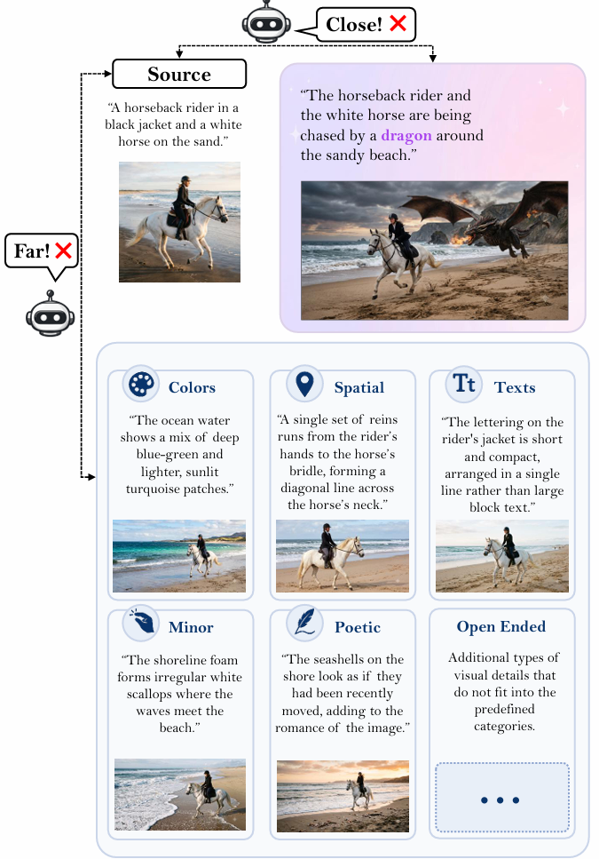

# Seeing Between the Lines: Measuring Visual Similarity from Text Alone

> **Dana Levin, Tomer Morad, Dafna Shahaf**
> The Hebrew University of Jerusalem

> GMultimodal embedding models align images with their textual descriptions, suggesting that they should also capture visual similarity between texts. Surprisingly, we show that this is often not the case: existing models struggle to distinguish visually consequential changes from textually specific but perceptually minor details. We formalize this capability as a new task, visual similarity between texts, and introduce $\benchmark$ {\it (Visual Similarity from Text Alone)}, a large-scale contrastive benchmark targeting common failure modes. We further present \model, which substantially improves performance on the task while preserving CLIP’s existing visual-semantic capabilities.

  

## Contact
For any questions, please send an email to Dana.Levin@mail.huji.ac.il and Tomer.Morad@mail.huji.ac.il